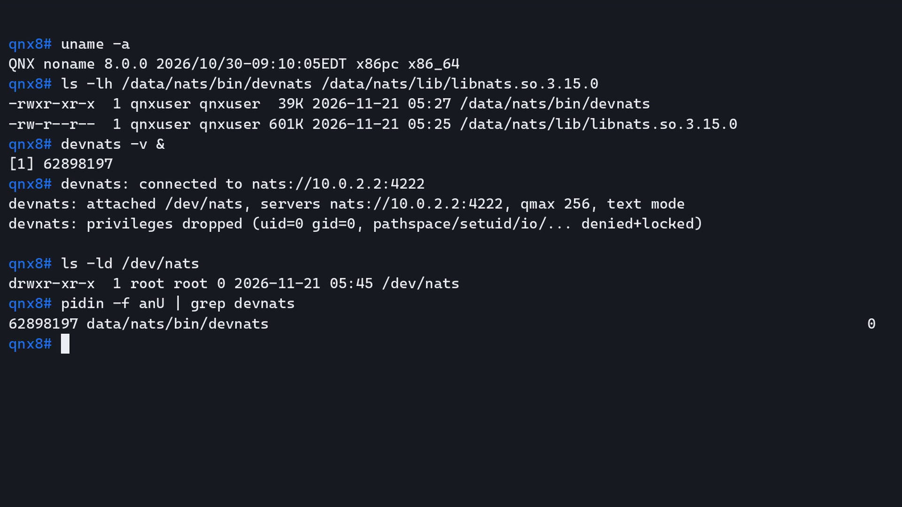
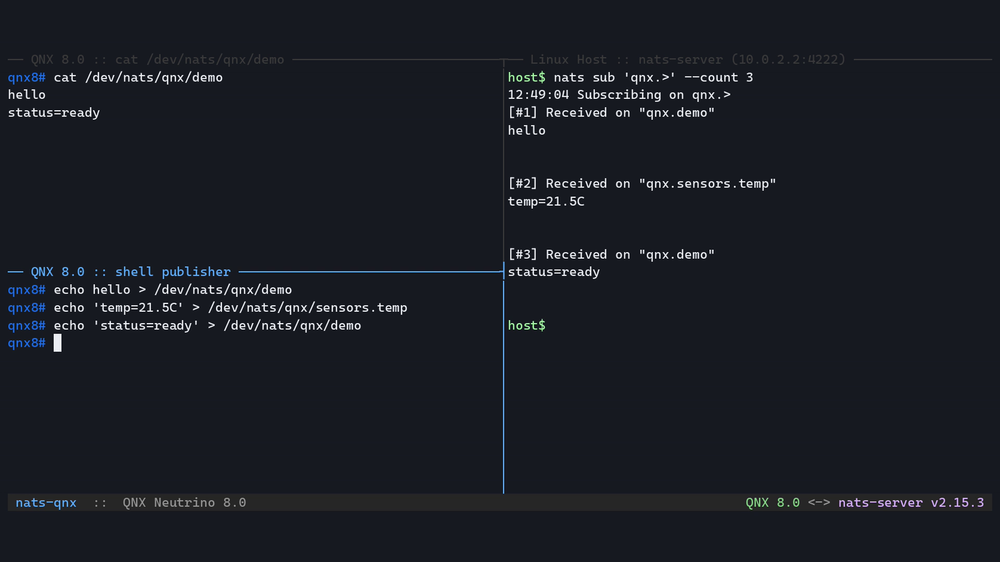
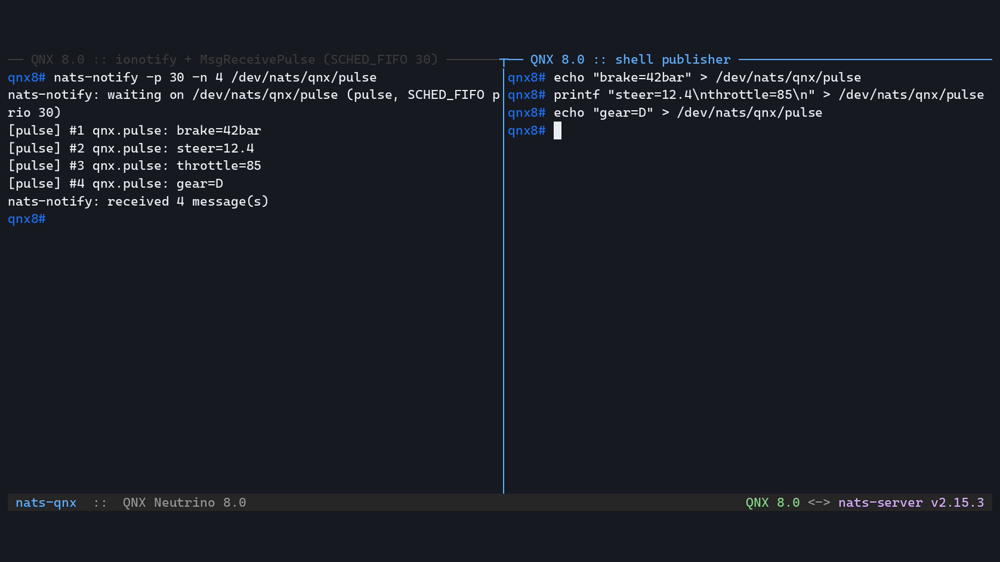
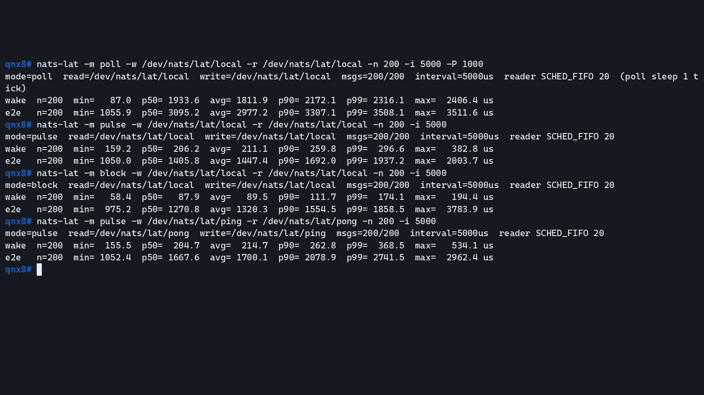

# Codelab: Native NATS & `/dev/nats` Resource Manager on QNX 8.0

**Estimated time:** 50–60 minutes · **Level:** Intermediate (C / POSIX / QNX Neutrino)
**Target:** QNX SDP **8.0** (`QNX Neutrino 8.0.0`), **`qcc`** (GCC 12.2.0), **`x86_64`** QEMU guest (also cross-compiles for **`aarch64le`**)

In this codelab you will cross-compile the official C NATS client ([nats.c](https://github.com/nats-io/nats.c) v3.15.0 with OpenSSL 3 TLS) for QNX Neutrino 8.0, run it against a NATS broker on your Linux host, and build **`devnats`**—a QNX resource manager that exposes NATS pub/sub, request/reply, JetStream, and real-time `ionotify()` pulses under **`/dev/nats`**.

## What you will learn

* How to cross-compile a CMake C library for QNX 8.0 with `qcc` and handle real QNX libc / `io-sock` differences.
* How to deploy to a QNX 8.0 QEMU target and bridge traffic over QEMU user-mode networking (`10.0.2.2`).
* How QNX resource managers work (`resmgr_attach`, `iofunc_*`, per-`open()` OCBs, thread pools, `_RESMGR_NOREPLY`, `io_unblock`, `procmgr_ability`, `slog2`).
* How to wake a `SCHED_FIFO` real-time client via `MsgRegisterEvent()` + `ionotify()` + `MsgReceivePulse()`—and why it beats polling by **~9×** at p50 wake latency.

## Prerequisites

* **Linux x86_64 dev host** with `git`, `cmake` (≥ 3.13; tested 3.31), `ninja`, `curl`, `unzip`, and `qemu-system-x86_64`.
* **QNX SDP 8.0** installed (e.g. `$HOME/qnx800`), using the free QNX Everywhere / non-commercial licence from myQNX.
* **QNX 8.0 x86_64 QEMU image** created with `mkqnximage --type=qemu --arch=x86_64` with SSH forwarded to host port `2222` (the repo scripts assume SSH key auth as `root` on `127.0.0.1:2222`).

---

## Step 1 — Cross-compile `nats.c` and `devnats` for QNX 8.0 (~10 min)

Clone the repository and point `QNX_SDP` at your SDP 8.0 installation:

```bash
git clone https://github.com/yohunshadow/nats-qnx.git
cd nats-qnx
export QNX_SDP=$HOME/qnx800
./build.sh x86_64
```

To build for **both** `x86_64` and `aarch64le` (e.g. Raspberry Pi 5):

```bash
./build.sh all
```

### What `build.sh` does under the hood

1. Sources `$QNX_SDP/qnxsdp-env.sh` so `qcc`, `QNX_HOST`, and `QNX_TARGET` are set.
2. Clones `nats-io/nats.c` at tag `v3.15.0` into `build/` and applies five focused patches in `patches/`:
   * `0001`: Link `socket` (`libsocket`) instead of `rt` (`librt` does not exist on QNX; `clock_gettime()` is in `libc`).
   * `0002`: Guard `<execinfo.h>` / `backtrace()` in the upstream test-suite with `!defined(__QNX__)`.
   * `0003`: Avoid `printf("%s", NULL)` in the test-suite (QNX `libc` dereferences `NULL`, causing `SIGSEGV`).
   * `0004`: Fix two latent `printf("%s", NULL)` bugs **inside `libnats` itself** (`NATS_SSL_ERR_REASON_STRING` and `js_directGetMsgToJSMsg()` error paths).
   * `0005`: Treat `ECONNABORTED` from `accept()` as a dialed-but-reset socket in a mock-server unit test (`io-sock` behaviour).
3. Invokes CMake with `cmake/qnx-toolchain.cmake` (`CMAKE_SYSTEM_NAME=QNX`, `qcc -Vgcc_ntox86_64`), finding OpenSSL 3.0.22 inside `$QNX_TARGET`.
4. Cross-compiles `devnats/devnats.c` and the example clients (`nats-notify`, `nats-ctl`, `nats-lat`) with `qcc`.

### Checkpoint 1

Verify the installed library and resource-manager binaries exist and match the target architecture:

```bash
ls -lh out/x86_64/lib/libnats.so.3.15.0 out/x86_64/bin/devnats
readelf -h out/x86_64/bin/devnats | grep Machine
```

Expected output (sizes from our QNX SDP 8.0 build):

```text
-rwxr-xr-x 1 user user  39K ... out/x86_64/bin/devnats
-rw-r--r-- 1 user user 601K ... out/x86_64/lib/libnats.so.3.15.0
  Machine:                           Advanced Micro Devices X86-64
```

---

## Step 2 — Boot QNX 8.0 QEMU, start the broker, and run the smoke test (~10 min)

Go has no QNX port, so `nats-server` runs on your Linux dev host while QNX clients connect over QEMU user-mode networking (SLIRP). Inside the QNX guest, the host is always **`10.0.2.2`**.

> **Important:** The host broker **must** listen on `0.0.0.0:4222`, not `127.0.0.1:4222`, otherwise QEMU's SLIRP gateway cannot reach it.

On the **Linux host**:

```bash
scripts/host-nats-server.sh start        # downloads nats-server v2.15.3 + CLI v0.5.2, runs -a 0.0.0.0 -p 4222 -js
scripts/host-nats-server.sh status
```

Expected output:

```text
nats-server running (pid ...) on 0.0.0.0:4222, JetStream /tmp/nats-qnx-js
```

Now deploy the cross-compiled library, examples, and `devnats` to `/data/nats` on your running QNX 8.0 QEMU guest (adjust `SSH_KEY` / `SSH_PORT` if yours differ):

```bash
export SSH_KEY=/path/to/your/qnx_qemu_key
./deploy.sh x86_64
```

SSH into the QNX guest and run `qnx-smoke` (core pub/sub, request/reply, JetStream file stream + durable pull consumer, and Key/Value):

```sh
ssh -p 2222 -i "$SSH_KEY" root@127.0.0.1
export LD_LIBRARY_PATH=/data/nats/lib
export PATH=/data/nats/bin:$PATH
uname -a
qnx-smoke nats://10.0.2.2:4222 5
```

Expected output (abbreviated from `proof/proof-x86_64.txt`):

```text
QNX noname 8.0.0 2026/10/30-09:10:05EDT x86pc x86_64
qnx-smoke: nats.c 3.15.0 on QNX 8.0.0 x86pc, server nats://10.0.2.2:4222
[connect] OK server_id=...
[pubsub] recv qnx.smoke.core: core message 1 from QNX
...
[pubsub] OK 5/5
[reqrep] OK reply: pong from QNX 8.0.0 x86pc (pid 54513685): ping
[jetstream] stream QNX_SMOKE created (file storage)
[jetstream] published seq=1 stream=QNX_SMOKE
...
[jetstream] consumed stream_seq=1: {"seq":1,"src":"qnx","temp_c":21}
...
[jetstream] OK published+consumed+acked 5/5
[kv] OK board.os = QNX (revision 1)
qnx-smoke: ALL OK
```

### Checkpoint 2

You can also run `demo/run-proof.sh x86_64` from the host to verify bi-directional host ↔ guest pub/sub and TLS (correct CA succeeds; mismatched CA fails cleanly with `SSL handshake error: 20:unable to get local issuer certificate` rather than crashing).

---

## Step 3 — Mount `/dev/nats` and use NATS over POSIX file I/O (~10 min)

Linking `libnats` works well for new C applications, but QNX's superpower is **resource managers**: any user-space server can register a prefix in the global pathname space and turn IPC messages into ordinary `open()`, `read()`, `write()`, `select()`, and `devctl()` calls.

```text
 QNX guest                                                       Linux host
 ┌──────────────────────────────────────────────────────┐
 │ shell: echo / cat   C app: open/read/write/devctl    │
 │ RT client: ionotify + MsgReceivePulse (SCHED_FIFO)   │
 │        │   POSIX I/O = QNX messages   ▲ reply/pulse  │
 │        ▼                              │              │
 │  ┌──────────── devnats (resmgr) ──────────────────┐  │
 │  │ thread pool ─ io_open/read/write/notify/devctl │  │
 │  │ per-fd OCB: subject, ring queue, waiters,      │  │   ┌──────────────┐
 │  │             drops, notify list                 │  │   │ nats-server  │
 │  │ libnats (one conn, auto-reconnect, TLS) ◄──────┼──┼──►│ 0.0.0.0:4222 │
 │  │ slog2 "devnats", procmgr_ability drop, SIGTERM │  │   │ + JetStream  │
 │  └────────────────────────────────────────────────┘  │   └──────────────┘
 └──────────────────────────────────────────────────────┘     ▲ nats sub/pub
```

### Path-to-subject rules

* `/dev/nats/qnx/demo` → subject `qnx.demo`
* Dots inside a path component stay dots: `/dev/nats/qnx/sensors.temp` → `qnx.sensors.temp`
* Wildcards `*` and `>` are valid for `O_RDONLY` (`/dev/nats/qnx/*`, `/dev/nats/qnx/>`), rejected with `EINVAL` for writes or when `>` is not the final token.

### Start `devnats` on the QNX guest

```sh
devnats -v &
ls -ld /dev/nats
pidin -f anU | grep devnats
```

Expected output:

```text
devnats: connected to nats://10.0.2.2:4222
devnats: attached /dev/nats, servers nats://10.0.2.2:4222, qmax 256, text mode
devnats: privileges dropped (uid=0 gid=0, pathspace/setuid/io/... denied+locked)
drwxr-xr-x  1 root root 0 2026-11-21 05:45 /dev/nats
62898197 data/nats/bin/devnats                                                                  0
```



### Shell pub/sub & Linux host interop

On the **Linux host**, subscribe to `qnx.>`:

```bash
./hostbin/nats -s nats://127.0.0.1:4222 sub 'qnx.>' --count 3
```

On the **QNX guest**, start a reader in the background and publish three lines:

```sh
cat /dev/nats/qnx/demo &
echo hello > /dev/nats/qnx/demo
echo 'temp=21.5C' > /dev/nats/qnx/sensors.temp
echo 'status=ready' > /dev/nats/qnx/demo
```

Both the QNX `cat` reader and the Linux `nats sub` terminal receive the messages immediately:

```text
[#1] Received on "qnx.demo"
hello
[#2] Received on "qnx.sensors.temp"
temp=21.5C
[#3] Received on "qnx.demo"
status=ready
```



And in reverse—publishing from the Linux host to a waiting `cat` on QNX:

```sh
# QNX guest:
cat /dev/nats/host/cmd
```

```bash
# Linux host:
./hostbin/nats -s nats://127.0.0.1:4222 pub host.cmd "start motor"
./hostbin/nats -s nats://127.0.0.1:4222 pub host.cmd "stop motor"
```

### Request/reply and JetStream via `devctl()`

First, create a JetStream stream `DEVNATS` and start the host echo helper (optional, or use `nats reply`):

```bash
# Linux host:
./hostbin/nats -s nats://127.0.0.1:4222 stream add DEVNATS --subjects 'devnats.js.>' --storage file --defaults
gcc -O2 -Iout/host/include -o hostbin/host-echo tools/host-echo.c out/host/lib/libnats_static.a -lpthread
./hostbin/host-echo &
```

On the **QNX guest**, run request/reply, JetStream publish (including `Msg-Id` deduplication), and stats:

```sh
nats-ctl req /dev/nats/svc/echo "hi from qnx" 2000
nats-ctl jspub /dev/nats/devnats/js/demo '{"temp":24.5}' tel-9603
nats-ctl jspub /dev/nats/devnats/js/demo '{"temp":24.5}' tel-9603
nats-ctl stats /dev/nats
```

Expected output (`proof/proof-devnats.txt` & live capture):

```text
reply: echo: hi from qnx
jspub ack: stream=DEVNATS seq=6 duplicate=0
jspub ack: stream=DEVNATS seq=6 duplicate=1
server=nats://10.0.2.2:4222 connected=1 reconnects=0 opens=1
global: msgs_in=... msgs_out=... bytes_in=... bytes_out=... drops=0
```

### Checkpoint 3

Kill the background `cat` if still open, and confirm `nats-ctl nbread /dev/nats/qnx/empty` prints `read -> -1 errno=EAGAIN`.

---

## Step 4 — Walkthrough: Writing a QNX resource manager (`devnats.c`) (~15 min)

If you want to build your own QNX resource manager—whether for NATS, CAN, or custom telemetry—`devnats/devnats.c` demonstrates the five essential patterns.

### 4.1 Override `IOFUNC_*` and `RESMGR_*` types *before* system headers

QNX's `iofunc_*` helpers take `IOFUNC_ATTR_T *` and `IOFUNC_OCB_T *`. Defining those macros before `#include <sys/dispatch.h>` and `<sys/iofunc.h>` gives you compiler type-checking with zero unsafe casts (`devnats/devnats.c:36–47`):

```c
struct dn_ocb;
struct dn_attr;
#define IOFUNC_OCB_T        struct dn_ocb
#define IOFUNC_ATTR_T       struct dn_attr
#define RESMGR_OCB_T        struct dn_ocb
#define RESMGR_HANDLE_T     struct dn_attr
#define THREAD_POOL_PARAM_T dispatch_context_t
#include <sys/dispatch.h>
#include <sys/iofunc.h>
```

Each `open()` creates a per-open attribute (`struct dn_attr`) holding the mapped subject and an OCB (`struct dn_ocb`) allocated via `iofunc_mount_t.funcs` (`ocb_calloc` / `ocb_free`) holding:
* `natsSubscription *sub` (if opened `O_RDONLY` / `O_RDWR`),
* a bounded FIFO ring (`head`, `tail`, `count`, `qmax`, `drops`),
* up to `16` blocked reader `rcvid`s (`waiters[]`),
* `iofunc_notify_t notify[3]` for `ionotify` / `select` / `poll`,
* a `pthread_mutex_t mu` protecting all of the above.

### 4.2 Attach the path prefix and start a thread pool

Passing `_RESMGR_FLAG_DIR` to `resmgr_attach()` tells QNX's pathname manager to route every path under `/dev/nats/...` to `dn_open()`. Notice `rattr.msg_max_size = 16384` so `4 KiB` request/JetStream `devctl()` structs arrive in a single message (`devnats/devnats.c:967–1021`):

```c
iofunc_func_init(_RESMGR_CONNECT_NFUNCS, &g_cfuncs, _RESMGR_IO_NFUNCS, &g_iofuncs);
g_cfuncs.open    = dn_open;
g_iofuncs.read   = dn_read;
g_iofuncs.write  = dn_write;
g_iofuncs.notify = dn_notify;
g_iofuncs.unblock = dn_unblock;
g_iofuncs.close_ocb = dn_close_ocb;
g_iofuncs.devctl = dn_devctl;
...
g_rid = resmgr_attach(g_dpp, &rattr, mount_path, _FTYPE_ANY, _RESMGR_FLAG_DIR,
                      &g_cfuncs, &g_iofuncs, &g_root);
...
tpp = thread_pool_create(&pattr, POOL_FLAG_EXIT_SELF);
thread_pool_start(tpp);
```

### 4.3 Block readers *without* blocking a thread-pool worker

Never sleep inside a resource manager's `io_read` handler—you would exhaust the thread pool. Instead, when the OCB queue is empty (and `O_NONBLOCK` is not set), stash `ctp->rcvid` and return **`_RESMGR_NOREPLY`** (`devnats/devnats.c:462–489`). The client remains REPLY-blocked while the pool thread returns immediately to serve other clients:

```c
    if ((m = q_pop(o)) != NULL) {
        deliver(o, ctp->rcvid, msg->i.nbytes, m);
        pthread_mutex_unlock(&o->mu);
        free(m);
        return _RESMGR_NOREPLY;
    }
    if (nonblock || g_shutting_down) {
        ...
        return EAGAIN;
    }
    o->waiters[o->nwaiters].rcvid = ctp->rcvid;
    o->waiters[o->nwaiters].nbytes = msg->i.nbytes;
    o->nwaiters++;
    pthread_mutex_unlock(&o->mu);
    return _RESMGR_NOREPLY;
```

When `nats.c`'s global delivery thread invokes `on_msg()`, it either replies directly to a waiting `rcvid` via `MsgReplyv()` (`deliver()`), or pushes into the bounded ring (dropping the oldest message if full) and fires `iofunc_notify_trigger()` (`devnats/devnats.c:274–292`):

```c
    pthread_mutex_lock(&o->mu);
    o->in++;
    if (o->nwaiters > 0) {
        dn_waiter_t w = o->waiters[0];
        memmove(&o->waiters[0], &o->waiters[1], (size_t)(o->nwaiters - 1) * sizeof(w));
        o->nwaiters--;
        deliver(o, w.rcvid, w.nbytes, m);
        free(m);
    } else {
        if (o->count >= o->qmax) {
            free(q_pop(o));                   /* drop oldest */
            o->drops++;
            atomic_fetch_add(&g_drops, 1);
        }
        q_push(o, m);
        if (IOFUNC_NOTIFY_INPUT_CHECK(o->notify, (int)o->count, 0))
            iofunc_notify_trigger(o->notify, (int)o->count, IOFUNC_NOTIFY_INPUT);
    }
    pthread_mutex_unlock(&o->mu);
```

### 4.4 Handle signal unblocking and `ionotify` locking cleanly

Two subtle QNX rules you must get right:

1. **`io_unblock` race check:** When a REPLY-blocked client receives a signal (e.g. `Ctrl+C` or `SIGALRM`), the kernel sends an unblock pulse to `dn_unblock()`. Always call `MsgInfo(ctp->rcvid, &info)` and only reply `EINTR` if **`info.flags & _NTO_MI_UNBLOCK_REQ`** is set (`devnats/devnats.c:568–571`)—otherwise `on_msg()` may already be replying with real data.
2. **Lock `o->mu` inside `dn_notify()`:** Because `on_msg()` triggers `o->notify` from a NATS callback thread outside the resmgr pool, `dn_notify()` must acquire `o->mu` around `iofunc_notify()` (`devnats/devnats.c:546–556`).

### 4.5 Drop privileges and shut down cleanly

After `resmgr_attach()`, `devnats` calls `procmgr_ability()` (`devnats/devnats.c:807–844`) to deny and lock 26 abilities it no longer needs (path-space attach, mount, spawn/fork, setuid/setgid, I/O & interrupt privileges, physical memory, clock set, reboot, etc.), and optionally switches to `-U qnxuser`. All worker threads inherit a blocked `SIGTERM`/`SIGINT`/`SIGHUP` mask so a dedicated `signal_thread()` catches shutdown, detaches `/dev/nats`, replies EOF (`0` bytes) to every blocked reader, closes NATS cleanly, and exits.

---

## Step 5 — Real-time event delivery with `ionotify()` pulses & latency (~10 min)

Polling `read(O_NONBLOCK)` in a `sleep()` loop wastes CPU and stalls up to one kernel tick per message. On QNX, an event-driven client uses **`ionotify()`** to hand the resource manager a lightweight **pulse**.

### 5.1 How `nats-notify.c` works

Open `devnats/examples/nats-notify.c`. The real-time loop follows four steps:

1. Create a private channel and side-channel connection (`ChannelCreate(_NTO_CHF_PRIVATE)`, `ConnectAttach(...)`).
2. Initialize a pulse `sigevent` and **register it for that fd** (`MsgRegisterEvent(&ev, fd)`—required on QNX 7.1+/8.0 so the kernel lets `devnats` deliver pulses to you):

```c
SIGEV_PULSE_INIT(&ev, coid, prio > 0 ? prio : SIGEV_PULSE_PRIO_INHERIT, PULSE_CODE_NATS, 0);
if (MsgRegisterEvent(&ev, fd) == -1) {
    perror("MsgRegisterEvent");
    return 1;
}
```

3. Arm with `ionotify(fd, _NOTIFY_ACTION_POLLARM, _NOTIFY_COND_INPUT, &ev)`. If `_NOTIFY_COND_INPUT` is not already set in the return mask, sleep zero-CPU in `MsgReceivePulse()`.
4. Drain all queued messages with non-blocking `read()` until `EAGAIN`, optionally querying `DCMD_NATS_LAST_MSGINFO` for the exact subject and timestamps.

Run it on the QNX guest at `SCHED_FIFO` priority 30 in one shell while publishing from another:

```sh
# Terminal 1 (QNX):
nats-notify -p 30 -n 4 /dev/nats/qnx/pulse
```

```sh
# Terminal 2 (QNX):
echo "brake=42bar" > /dev/nats/qnx/pulse
printf "steer=12.4\nthrottle=85\n" > /dev/nats/qnx/pulse
echo "gear=D" > /dev/nats/qnx/pulse
```

Expected output:

```text
nats-notify: waiting on /dev/nats/qnx/pulse (pulse, SCHED_FIFO prio 30)
[pulse] #1 qnx.pulse: brake=42bar
[pulse] #2 qnx.pulse: steer=12.4
[pulse] #3 qnx.pulse: throttle=85
[pulse] #4 qnx.pulse: gear=D
nats-notify: received 4 message(s)
```



### 5.2 Measure wake-up latency: `ionotify` pulse vs polling

Run `nats-lat` on the QNX guest (`SCHED_FIFO 20`, 5 ms publish interval):

```sh
nats-lat -m poll  -w /dev/nats/lat/local -r /dev/nats/lat/local -n 500 -i 5000 -P 1000
nats-lat -m pulse -w /dev/nats/lat/local -r /dev/nats/lat/local -n 500 -i 5000
nats-lat -m block -w /dev/nats/lat/local -r /dev/nats/lat/local -n 500 -i 5000
nats-lat -m pulse -w /dev/nats/lat/ping  -r /dev/nats/lat/pong  -n 500 -i 5000
```

Verified numbers from `proof/proof-devnats.txt` (500 messages each, µs):

| Reader mode | Wake p50 | Wake p99 | End-to-End p50 | End-to-End p99 |
|---|---:|---:|---:|---:|
| Blocking `read()` | 89.7 µs | 144.0 µs | 1277.4 µs | 2110.2 µs |
| **`ionotify` + pulse** | **205.2 µs** | **339.5 µs** | **1390.0 µs** | **3547.9 µs** |
| Polling loop (1-tick sleep) | 1907.3 µs | 2371.4 µs | 3076.1 µs | 3427.5 µs |
| Pulse RTT (guest → host echo → guest) | 202.3 µs | 346.3 µs | 1651.6 µs | 2473.9 µs |

* **Wake** = client read timestamp minus `devnats` enqueue timestamp (`CLOCK_MONOTONIC`, same guest clock).
* **End-to-End** = client read timestamp minus writer write timestamp (includes `write()` → `devnats` → host `nats-server` → `devnats` → `read()`).
* **QEMU TCG caveat:** The QEMU guest runs under software emulation (no KVM), which inflates absolute microseconds; compare modes relative to each other and re-measure on real hardware. Even under TCG, `ionotify` pulses wake **~9.3× faster at p50** than polling with tight tail jitter.



### Checkpoint 4 — Run the full automated test suite

From the **Linux host**, run the end-to-end runner (`29/29` TAP checks + shell demo + latency):

```bash
./devnats/tests/run-tests.sh | tee proof/proof-devnats.txt
```

Expected tail output:

```text
1..29
# 29/29 passed
...
functional tests: PASS
```

---

## Step 6 — Troubleshooting (real QNX 8.0 & QEMU pitfalls)

| Symptom | Root cause | Fix / explanation |
|---|---|---|
| `ld: cannot find -lrt` when porting `nats.c` | QNX puts `clock_gettime()` in `libc` (no `librt`) and BSD sockets in `libsocket` | `patches/0001` sets `NATS_EXTRA_LIB=socket` on `QNX`. Link apps with `-lnats -lsocket` (plus `-lssl -lcrypto` for TLS). |
| `Error: signal 11` in `nats.c` / tests | QNX `libc` dereferences `NULL` in `printf("%s", NULL)` (unlike glibc) | `patches/0003` and `0004` guard `NULL` pointers in test banners and `libnats` SSL / JetStream direct-get error strings. |
| `accept()` fails with `ECONNABORTED` | QNX 8.0 `io-sock` drops sockets reset (`SO_LINGER {1,0}`) before `accept()` | `patches/0005` handles `ECONNABORTED` in the mock-server test; write QNX servers to treat `ECONNABORTED` from `accept()` as transient. |
| Guest times out connecting to `10.0.2.2:4222` | `nats-server` bound only to `127.0.0.1` | Start `nats-server -a 0.0.0.0 -p 4222 -js` (handled by `scripts/host-nats-server.sh start`). |
| IPv6 unit tests fail (`natsSock_IPOrder`, `IPResolutionOrder`) | QEMU user-net IPv6 is unconfigured for host forwarding | Expected under QEMU SLIRP; IPv4 and TLS run normally (`329/336` upstream pass). |
| Guest timestamps drift or `natsTimer` fails | QEMU TCG software emulation slows wall clock & timers | Resync guest clock before runs: `ssh ... "date -u $(date -u +%m%d%H%M%Y.%S)"`. |
| Background `cat /dev/nats/... &` exits without printing | Exiting an `ssh` session sends `SIGHUP` to its background jobs | Start background readers with `nohup` or keep reader & writer in the same shell session. |
| `ionotify()` fails (`EINVAL` / `EPERM`) or `_NOTIFY_ACTION_POLLARM` undeclared | QNX 7.1+/8.0 requires explicit event registration; macros live in `<sys/iomsg.h>` | `#include <sys/iomsg.h>` and call `MsgRegisterEvent(&ev, fd)` before `ionotify()`. |
| Custom `devctl()` returns `EINVAL` or collides | QNX `_DCMD_*` command field is **8 bits** (`0..255`) | Keep command codes `<= 0xff` (e.g. `0x41–0x48` in `devnats/devnats.h`), and return errno directly instead of packing it in `msg->o.ret_val`. |

---

## Step 7 — Final exercise: Build a Sensor Watchdog on `/dev/nats`

Put everything together with a small two-part safety watchdog on the QNX guest:

1. **Alert listener (`C` or `nats-notify` + shell):**
   * Subscribe to `/dev/nats/plant/sensors/*` (single-token wildcard) using `MsgRegisterEvent()` + `ionotify()` + `MsgReceivePulse()` at `SCHED_FIFO` priority `25`.
   * Whenever a payload's temperature exceeds `80.0`, publish an audit record to JetStream on `/dev/nats/devnats/js/audit` using `DCMD_NATS_JS_PUBLISH` with a deterministic `Msg-Id` (so retries are deduplicated), and query `/dev/nats/svc/echo` via `DCMD_NATS_REQUEST`.
2. **Backpressure test:**
   * Open `/dev/nats/plant/burst` with `O_RDONLY`, set `DCMD_NATS_SET_QMAX` to `8`, publish `20` lines before reading, and inspect `DCMD_NATS_GET_STATS` (`nats-ctl stats /dev/nats/plant/burst`—or print `s.ocb_drops` in C) to verify `drops=12` and `queued=8`.

<details>
<summary>Hints & verification commands</summary>

* Test the backpressure math immediately from the shell using `nats-ctl flood`:
  ```sh
  nats-ctl flood /dev/nats/plant/burst 8 3000 &
  sleep 1
  i=1; while [ $i -le 20 ]; do echo "sample=$i"; i=$((i+1)); done > /dev/nats/plant/burst
  wait
  ```
  You should see `in=20 out=0 drops=12 queued=8 qmax=8`.
* Verify your JetStream audit messages from the Linux host:
  ```bash
  ./hostbin/nats -s nats://127.0.0.1:4222 stream view DEVNATS
  ```
* Inspect `devnats/examples/nats-notify.c` and `devnats/examples/nats-ctl.c` for minimal working `ionotify` and `devctl` templates you can copy and extend.

</details>

---

## Next steps

* Read [NOTES.md](../NOTES.md) for full details on all 336 upstream unit tests and `devnats` internals.
* Try deploying to **`aarch64le`** hardware (`./build.sh aarch64le`, binaries output to `out/aarch64le/`).
* Explore adding `/dev/nats/kv/<bucket>/<key>` and NATS message headers via `devctl()` as extensions to `devnats/devnats.c`.
